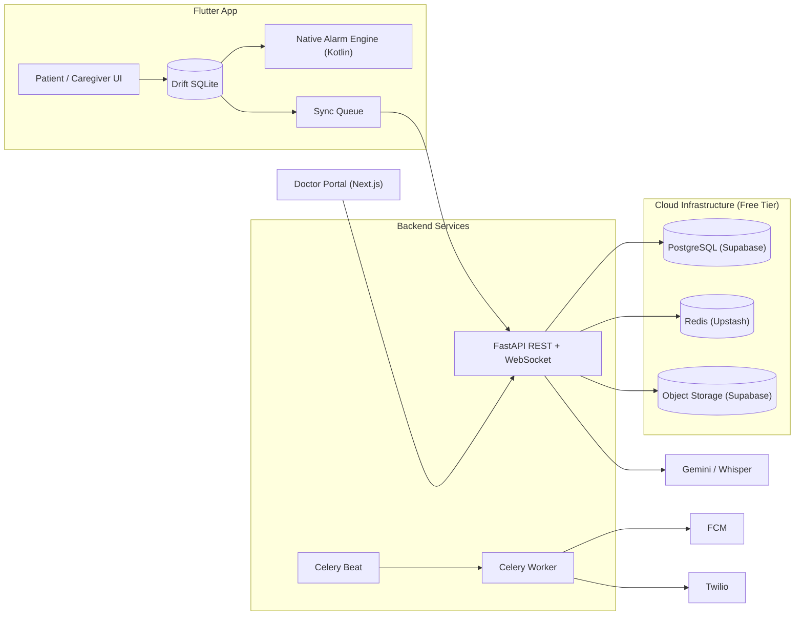
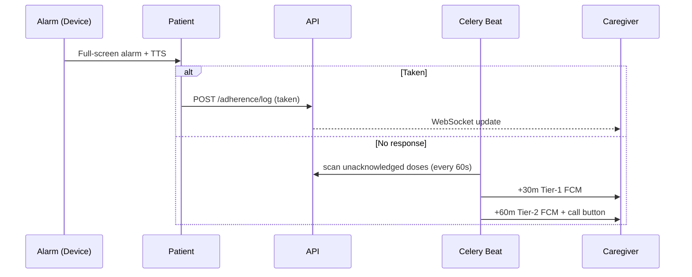
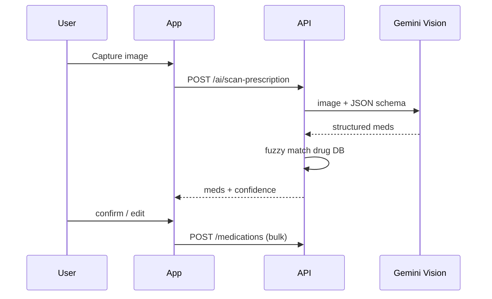
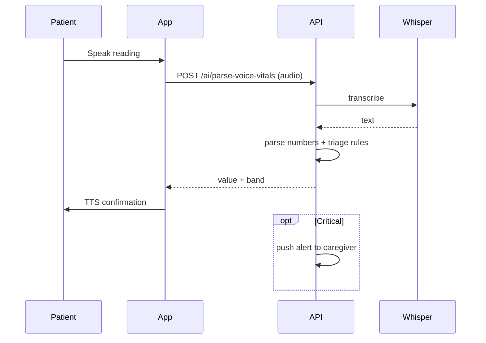

# المعمارية (Architecture)

## النظرة العامة

## طبقات تطبيق Flutter (Clean Architecture)
- `presentation/` Widgets + Riverpod Notifiers
- `domain/` Entities + UseCases + Repository interfaces
- `data/` Drift DAOs + Dio remote sources + Repository impl

## Offline-First
1. كل كتابة تروح SQLite بحالة `pending` + `client_uuid`.
2. الـ Sync Queue يبعت `POST /sync/batch` عند توفر الإنترنت (WorkManager كل 15 د + عند فتح التطبيق).
3. السيرفر Idempotent على `client_uuid`.
4. التعارض: السيرفر مرجع للأدوية/المواعيد، والجهاز مرجع لسجلات الجرعات.
5. المنبهات تتجدول محلياً من SQLite فقط — لا تعتمد على السيرفر.

## المنبه الصارم (Android)
- صلاحيات: `SCHEDULE_EXACT_ALARM`, `USE_EXACT_ALARM`, `USE_FULL_SCREEN_INTENT`, `RECEIVE_BOOT_COMPLETED`, `WAKE_LOCK`, `POST_NOTIFICATIONS`.
- `AlarmManager.setExactAndAllowWhileIdle()` + Full-Screen Intent.
- `BootReceiver` يعيد جدولة كل المنبهات من SQLite.
- إرشاد المستخدم لإيقاف Battery Optimization (خصوصاً Xiaomi/Oppo/Huawei).

## Sequence: الجرعة والتصعيد

## Sequence: مسح الروشتة

## Sequence: القياس الصوتي

