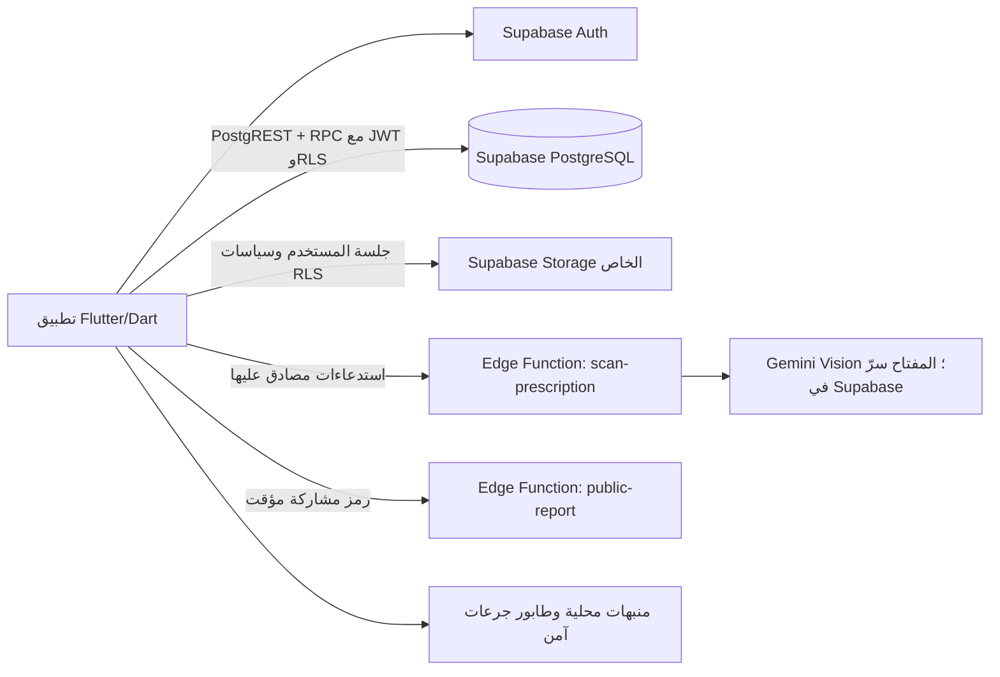

# المعمارية

## النظرة العامة

## طبقات تطبيق Flutter

- presentation/: الشاشات وWidgets وRiverpod Notifiers.
- domain/: النماذج وعقود الميزات.
- data/: مستودعات Supabase Auth/PostgREST/RPC/Storage وعمليات المزامنة المحلية.

## العمليات والاتصال

- Supabase Auth يدير تسجيل الدخول بالبريد وكلمة المرور والجلسات.
- التطبيق يتصل بقاعدة Supabase مباشرة باستخدام المفتاح العام وجلسة المستخدم؛ سياسات RLS تحدد الصفوف المسموح بها.
- عمليات الجرعات والقياسات والتصعيد التي تحتاج معاملة ذرية تنفذها دوال PostgreSQL المصرح بها.
- صور الروشتات وصور الأدوية تحفظ في Storage الخاص، وتُقرأ بروابط موقعة بعد التحقق من RLS.
- OCR يعمل في scan-prescription، ويقرأ الصورة والكتالوج بنطاق جلسة المستخدم؛ مفتاح Gemini يبقى في أسرار Supabase.
- التقرير العام يمر عبر public-report ويتحقق من رمز مشاركة محدود الصلاحية.

## العمل دون اتصال والمنبهات

1. تظل المنبهات محلية على الجهاز ولا تحتاج اتصالًا وقت الرنين.
2. تُحفظ سجلات الجرعات التي لم تُرسل في طابور التخزين الآمن على الجهاز.
3. عند عودة الاتصال، يعيد التطبيق إرسال السجلات إلى RPC record_intake_log مع client_uuid لمنع التكرار.
4. عند نجاح التسجيل، تُحدّث حالة الجرعة ويُحدّث جدول المنبهات المحلي.

## مسار الجرعة والقياس

- الجرعة: Flutter ←→ record_intake_log؛ تحفظ الدالة السجل وتتعامل مع خصم المخزون والتنبيه عند انخفاضه.
- القياس: Flutter ←→ record_vital؛ تتحقق الدالة من صلاحية الوصول وتحسب مستوى القراءة وتحفظ التنبيه الحرج في العملية نفسها.
- تنبيهات المرافق تُقرأ من list_patient_alerts مع فحص ارتباط المريض بالمرافق.

## إعدادات الأمان

- لا تضع secret أو service_role في Flutter؛ استخدم المفتاح العام فقط.
- أبقِ RLS مفعّلًا على الجداول المعروضة، وراجع سياسات الصفوف والتخزين مع كل تغيير.
- استخدم أسرار Supabase للاتصالات الخارجية داخل Edge Functions.
