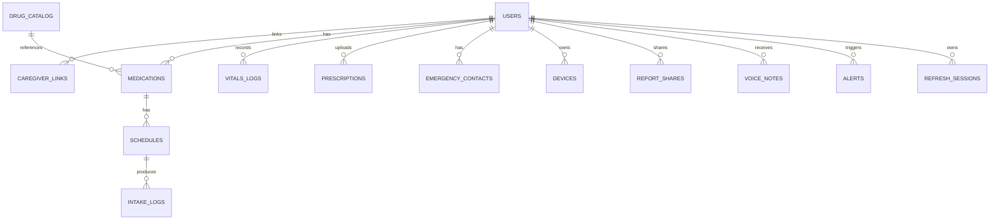

# قاعدة البيانات (PostgreSQL 16 - Supabase)

> مستضافة سحابياً عبر **Supabase** (PostgreSQL 16).
> كل الجداول فيها: `id UUID PK`, `created_at`, `updated_at`. الأوقات بـ `TIMESTAMPTZ` (UTC) والمنطقة الزمنية للمريض في `users.timezone`.

| الجدول | الحقول | ملاحظات |
|---|---|---|
| `users` | phone (unique), name, role ENUM(patient,caregiver,admin), language, timezone, birth_date, address | |
| `caregiver_links` | caregiver_id FK, patient_id FK, pairing_code, status ENUM(pending,active,revoked), permissions_mask INT, linked_at | unique(caregiver_id, patient_id) |
| `drug_catalog` | trade_name, active_ingredient, strength, form, manufacturer, price_egp | فهرس trigram للبحث |
| `medications` | patient_id FK, drug_catalog_id FK?, name, trade_name, form, strength, pill_image_url, stock_count, alert_threshold_days, expiry_date, is_active | |
| `schedules` | medication_id FK, time_of_day TIME, days_mask SMALLINT, dose_amount NUMERIC, meal_relation ENUM, instructions_ar, start_date, end_date, is_active | |
| `intake_logs` | client_uuid (unique), schedule_id FK, patient_id FK, scheduled_time, actual_time, status ENUM(taken,snoozed,missed,skipped), reason, logged_offline | index(patient_id, scheduled_time) |
| `vitals_logs` | client_uuid, patient_id FK, type ENUM(bp,glucose,pulse), value_primary, value_secondary, meal_context, band ENUM(normal,borderline,critical), raw_transcript, recorded_at | index(patient_id, type, recorded_at) |
| `prescriptions` | patient_id FK, image_url, doctor_name, raw_extracted_json JSONB, confidence, verified_at, verified_by | |
| `emergency_contacts` | patient_id FK, name, phone, relationship, is_primary, notify_sms, notify_call | |
| `devices` | user_id FK, fcm_token, platform, app_version, last_seen | |
| `report_shares` | patient_id FK, token_hash, scope, expires_at, views_count, revoked | |
| `voice_notes` | from_user FK, to_patient FK, medication_id FK?, audio_url, duration_s | |
| `alerts` | patient_id FK, type ENUM(missed_dose,critical_vital,low_stock,expiry,sos), tier, payload JSONB, sent_at, acknowledged_at | |
| `audit_logs` | actor_id, action, entity, entity_id, diff JSONB | |
| `refresh_sessions` | user_id FK, jti, token_hash, expires_at, revoked_at | لا يتم تخزين refresh token نفسه؛ rotation وإلغاء لكل جلسة |

## قاعدة الجهاز (Drift)
نسخة مصغرة: `medications`, `schedules`, `intake_logs`, `vitals_logs`, `sync_queue(id, entity, payload, status, retries)`.
