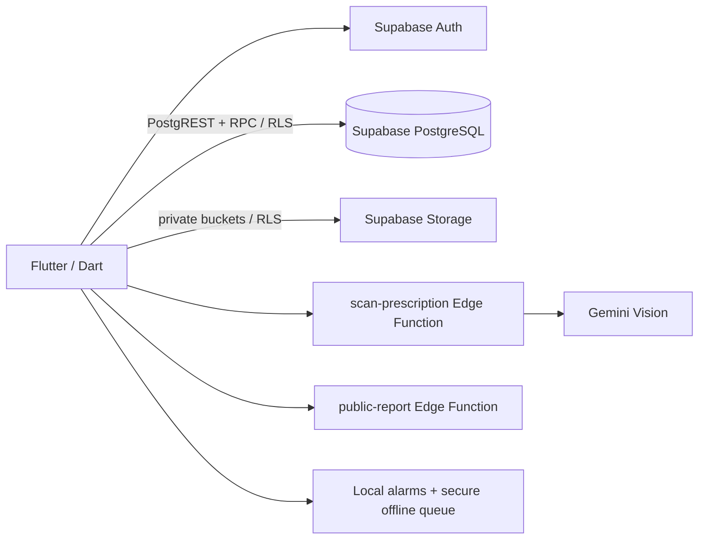
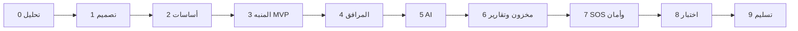

# 🩺 Medliva — الخطة الشاملة للمشروع (Master Project Plan)

> تطبيق ذكي لرعاية كبار السن: تذكير صارم بالأدوية، مسح الروشتات بالذكاء الاصطناعي، تسجيل القياسات يدويًا، متابعة لحظية من الأهل، إدارة مخزون الدواء، تقارير للطبيب، وزر استغاثة.
> المصدر: [original/](original/) · تفاصيل أعمق: [USE_CASES](USE_CASES.md) · [ARCHITECTURE](ARCHITECTURE.md) · [DATABASE](DATABASE.md) · [API_SPEC](API_SPEC.md) · [AI_PIPELINE](AI_PIPELINE.md) · [ROADMAP](ROADMAP.md) · [CONVENTIONS](CONVENTIONS.md) · [SECURITY](SECURITY.md)

> **الحالة التقنية الحالية:** المقترح الأصلي أدناه وثيقة تاريخية. التنفيذ الحالي Flutter/Dart مع Supabase Auth وPostgreSQL وRLS وStorage وEdge Functions. اتبع `docs/START_HERE.md` و`docs/EXECUTION_PLAN.md` عند العمل على الكود.

---

## 1. نظرة عامة

| البند | التفاصيل |
|---|---|
| **المشكلة** | نسيان الأدوية، صعوبة الكتابة على الموبايل لكبار السن، قلق الأهل البعيدين، نفاد الدواء فجأة، زيارات طبيب مبنية على الذاكرة |
| **الحل** | تطبيق Flutter بواجهتين (مريض/مرافق) وخدمات Supabase؛ الطبيب يستقبل تقرير PDF من التطبيق |
| **المستخدمون** | 👴 المريض (Senior) · 👨‍👩‍👧 المرافق (Caregiver) · 🩺 الطبيب (Doctor – بدون تثبيت) · 🛠️ الأدمن |
| **اللغات** | العربية (عامية مصرية + فصحى) والإنجليزية، RTL كامل |
| **مبادئ التصميم** | إدخال مبسط، أزرار كبيرة، تباين عالي (WCAG AA/AAA)، صوت TTS للتذكيرات، Offline-First |

### مؤشرات النجاح (KPIs)
- نسبة الالتزام الدوائي ≥ 90% للمستخدمين التجريبيين.
- دقة OCR للروشتات ≥ 85% (قبل التأكيد البشري).
- زمن وصول تنبيه المرافق < 5 ثوانٍ.
- المنبه يعمل 100% بدون إنترنت وبعد إعادة تشغيل الهاتف.

---

## 2. الميزات (Use Cases) والأولويات — MoSCoW

| ID | الميزة | الممثل | الأولوية |
|---|---|---|---|
| UC-01 | منبه الدواء الصارم (Full-Screen، Offline، Boot Recovery، TTS) | المريض | **Must** |
| UC-02 | مسح الروشتة بالـ AI (OCR + LLM → JSON + بطاقة تأكيد لو الثقة < 85%) | المرافق/المريض | **Must** |
| UC-03 | إدخال القياسات يدويًا + فرز طبي (طبيعي/حدّي/حرج) | المريض | **Must** |
| UC-04 | متابعة المرافق اللحظية + سلّم التصعيد (0 / +15 / +30 / +60 دقيقة) + رسائل صوتية من الأحفاد | المرافق | **Must** |
| UC-05 | مخزون الأقراص + توقع النفاد + تنبيه قبل 5 أيام + طلب صيدلية عبر WhatsApp + مراقبة الصلاحية | المرافق | **Should** |
| UC-06 | تقرير طبي (PDF) + QR مشفّر مؤقت لبوابة الطبيب | الطبيب | **Must** |
| UC-07 | زر الاستغاثة SOS (GPS + حفظ التنبيه + الاتصال بجهات الطوارئ) | المريض | **Must** |
| UC-08 | كشف التداخلات الدوائية (Drug Interactions) | النظام | Could |
| UC-09 | مساعد صوتي محادثي (أسئلة عن الأدوية) | المريض | Could |
| UC-10 | تكامل ساعات ذكية / أجهزة قياس Bluetooth | المريض | Won't (v1) |

---

## 3. الستاك المقترح (Recommended Tech Stack)

### 📱 Mobile (Patient + Caregiver)
| الطبقة | الاختيار | السبب |
|---|---|---|
| Framework | **Flutter 3.x (Dart)** | تطبيق واحد Android/iOS، أداء ممتاز، دعم RTL |
| State Management | **Riverpod 2** (+ `riverpod_generator`) | قابل للاختبار وبسيط |
| Navigation | **go_router** | Deep links (فتح شاشة المنبه / الـ QR) |
| Local persistence | طابور جرعات آمن على الجهاز | إعادة إرسال السجلات عند رجوع الاتصال |
| Networking | **supabase_flutter** | Auth وPostgREST وRPC وStorage وEdge Functions |
| Models | **freezed + json_serializable** | |
| Alarms | `android_alarm_manager_plus` + `flutter_local_notifications` (fullScreenIntent) + كود Native Kotlin لـ Boot Receiver | منبه صارم يتخطى Doze |
| Camera | `camera` + `image_cropper` + `google_mlkit_text_recognition` (معاينة محلية) | |
| Updates | Supabase Data API وRPC | لا يعتمد التطبيق على WebSocket مخصص |
| Charts | `fl_chart` | |
| Location | `geolocator` | SOS |

### ☁️ خدمات البيانات والتطبيق
| الطبقة | الاختيار |
|---|---|
| Data API | **Supabase PostgREST + PostgreSQL RPC** مع سياسات RLS |
| Schema changes | ملفات SQL مرتبة في `supabase/migrations` |
| Auth | **Supabase Auth** بالبريد وكلمة المرور |
| Storage | **Supabase Storage** خاص للروشتات وصور الأدوية |
| Server-side integrations | **Supabase Edge Functions**؛ أسرار Gemini تبقى داخل Supabase |
| PDF | Flutter `pdf` و`printing` داخل التطبيق |
| Notifications | تنبيهات داخل Supabase والتطبيق؛ تسجيل الأجهزة عبر RPC |

### 🤖 AI Layer
| المهمة | الاختيار الأساسي | البديل/Fallback |
|---|---|---|
| OCR + هيكلة الروشتة | **Gemini 2.x Flash (Vision) مع Structured Output (JSON Schema)** | Google Cloud Vision OCR + LLM |
| مطابقة أسماء الأدوية | كتالوج Supabase ومطابقة داخل Edge Function | |
| الفرز الطبي | **Rule Engine حتمي** (AHA/WHO) — بدون AI عمداً للأمان | |

### 🩺 تقرير الطبيب
- إنشاء PDF ومشاركته من تطبيق Flutter عبر رابط مؤقت يتحقق منه Supabase Edge Function.
- لا توجد بوابة ويب مستقلة للطبيب في النسخة الحالية.

### 🚀 DevOps & Cloud
- **قاعدة البيانات والتخزين:** Supabase PostgreSQL وStorage.
- **المنطق الموثوق:** SQL RPC مع RLS، وEdge Functions للأسرار أو مشاركة التقرير.
- **التشغيل المحلي:** Flutter مع مشروع Supabase المرتبط؛ لا يحتاج التطبيق إلى خادم محلي.
- **GitHub Actions:** فحوص Flutter وبناء APK.
- Monitoring: **Sentry** للتطبيق عند تفعيله.

---

## 4. معمارية النظام



### مبدأ Offline-First
1. تعمل المنبهات محليًا حتى دون اتصال.
2. تحفظ الجرعات غير المرسلة في طابور تخزين آمن على الجهاز.
3. يعيد التطبيق إرسال السجلات عبر `record_intake_log` مع `client_uuid` لمنع التكرار.

---

## 5. قاعدة البيانات

المخطط والجداول الفعلية وسياسات RLS موثقة في DATABASE.md. مشروع Supabase المرتبط هو مصدر البيانات الحالي؛ لا تعتمد على الجداول المقترحة في نسخ التخطيط السابقة.

---

## 6. تكاملات Supabase

- يستخدم Flutter Supabase Auth وPostgREST مباشرةً لقراءة البيانات وتعديلها ضمن RLS.
- تستخدم عمليات الكتابة الذرية دوال PostgreSQL RPC، مثل تسجيل الجرعات والقياسات وربط المرافق وSOS.
- تحفظ الصور في Supabase Storage الخاص وتحمي سياساته المريض والمرافق المرتبط.
- تنفذ scan-prescription مسح الروشتة، وتتحقق public-report من رابط المشاركة.
- تفاصيل العمليات والجداول موثقة في API_SPEC.md وDATABASE.md.

---

## 7. هيكل المستودع (Monorepo)

```
medliva/
├── apps/
│   ├── mobile/                 # Flutter
│   │   └── lib/
│   │       ├── core/           # alarms/, network/, theme/, tts/, db/, sync/
│   │       ├── features/
│   │       │   ├── auth/
│   │       │   ├── adherence_alarm/
│   │       │   ├── medications/
│   │       │   ├── prescription_ocr/
│   │       │   ├── caregiver_dashboard/
│   │       │   ├── inventory/
│   │       │   ├── reports/
│   │       │   └── emergency_sos/
│   │       │       └── {data, domain, presentation}/
│   │       └── main.dart
│   └── doctor-portal/          # Next.js
├── supabase/
│   ├── migrations/             # PostgreSQL, RLS, RPC
│   └── functions/              # TypeScript Edge Functions
├── docs/                       # هذا الملف، ERD، use cases، UML
└── .github/workflows/
```

---

## 8. مراحل التنفيذ (Roadmap) — ~16 أسبوع

| المرحلة | المدة | المخرجات |
|---|---|---|
| **0. التحليل والتخطيط** | أسبوع 1 | SRS، Use Cases، UML (Use Case / Sequence / Class)، Personas |
| **1. التصميم UX/UI** | أسبوع 2–3 | Wireframes + Figma Hi-Fi (وضع المريض المبسّط + وضع المرافق)، Design System بتباين عالي، اختبار مع 3–5 كبار سن |
| **2. الأساسات** | أسبوع 3–4 | Monorepo، إعداد Supabase، مخطط PostgreSQL وسياسات RLS، Supabase Auth، CI، Flutter + Theme + Localization |
| **3. MVP الأدوية والمنبه** ⭐ | أسبوع 5–7 | CRUD أدوية/مواعيد، Drift DB، المنبه الصارم Full-Screen، Boot Recovery، TTS، تسجيل الجرعة Offline + Sync |
| **4. المرافق والتنبيهات** | أسبوع 7–8 | Pairing، لوحة المرافق عبر Supabase RPC، التنبيهات، وسجل الجرعات |
| **5. طبقة الذكاء الاصطناعي** | أسبوع 9–11 | مسح الروشتة + بطاقة التأكيد، قاعدة أدوية مصرية؛ وإدخال القياسات اليدوي مع Rule Engine للفرز |
| **6. المخزون والتقارير** | أسبوع 11–12 | توقع النفاد، طلب WhatsApp، الصلاحية، PDF عربي، ورابط مشاركة مؤقت |
| **7. SOS والأمان** | أسبوع 13 | زر الاستغاثة + GPS وجهات الاتصال، تشفير، Rate limiting، Audit logs |
| **8. الاختبار والتحسين** | أسبوع 14–15 | Unit/Integration/E2E، اختبار ميداني (Pilot) مع عائلات، إصلاحات، أداء وبطارية |
| **9. التسليم** | أسبوع 16 | Deploy، APK موقّع، توثيق، فيديو Demo، عرض المناقشة والبحث |



### معايير قبول الـ MVP (نهاية المرحلة 4)
- [ ] المنبه يرن في الموعد بدون إنترنت، فوق شاشة القفل، وبعد Restart.
- [ ] المريض يؤكد الجرعة بضغطة واحدة ويظهر التأكيد عند المرافق خلال ثوانٍ.
- [ ] تصعيد تلقائي للمرافق عند عدم التأكيد خلال 30 دقيقة.

---

## 9. تقسيم الفريق المقترح (4–5 أفراد)

| الدور | المسؤوليات |
|---|---|
| Team Lead / Supabase | PostgreSQL، RLS وRPC، Edge Functions، DevOps |
| Mobile Dev 1 | المنبهات Native، Offline/Sync، واجهة المريض |
| Mobile Dev 2 | واجهة المرافق، Charts، SOS، Localization |
| AI Engineer | OCR، Parsers، قاعدة الأدوية، تقييم الدقة |
| UI/UX + QA + Docs | Figma، اختبار الاستخدام، التوثيق، Doctor Portal |

المنهجية: **Scrum** بسبرنت أسبوعين، GitHub Projects، Conventional Commits، Code Review إلزامي.

---

## 10. الاختبار والجودة

| النوع | الأدوات | التغطية |
|---|---|---|
| Unit (Supabase) | اختبارات SQL/RPC وEdge Functions عند تفعيلها | صلاحيات الصفوف، قواعد القياس والجرعات، وانتهاء روابط التقارير |
| Unit/Widget (Flutter) | flutter_test, mocktail | |
| Integration | اختبارات Flutter على مستودعات Supabase الوهمية أو بيئة اختبار | |
| E2E | Flutter `integration_test` / Patrol | سيناريو المنبه كامل |
| AI Evaluation | Dataset من 100+ روشتة | Precision/Recall لكل حقل |
| Usability | SUS Questionnaire مع كبار السن | هدف ≥ 75 |

---

## 11. الأمان والخصوصية

- بيانات صحية حساسة → HTTPS، RLS على قاعدة البيانات، buckets خاصة؛ طابور الجرعات يحفظ محليًا في تخزين آمن.
- روابط الطبيب: Token عشوائي مُجزّأ (hash) + انتهاء صلاحية 24–72 ساعة + Read-only.
- RBAC + صلاحيات المرافق (`permissions_mask`).
- موافقة صريحة (Consent) على مشاركة البيانات، والتزام بمبادئ قانون حماية البيانات المصري 151/2020 و HIPAA/GDPR كمرجعية.
- إخلاء مسؤولية طبي: الـ AI مساعد فقط، والتأكيد البشري إلزامي للروشتات.

---

## 12. المخاطر وخطط المعالجة

| الخطر | الأثر | المعالجة |
|---|---|---|
| قيود أندرويد على المنبهات (Doze / شركات زي Xiaomi) | عالي | Exact alarms + توجيه لإيقاف Battery Optimization + اختبار على أجهزة متعددة |
| ضعف دقة OCR لخط الأطباء | عالي | Human-in-the-loop + قاعدة أدوية + Fuzzy matching |
| تكلفة APIs | متوسط | Caching، Flash models، حدود استخدام |
| صعوبة الاستخدام لكبار السن | عالي | اختبارات مبكرة، واجهة مبسطة جداً، TTS |
| ضيق الوقت | عالي | الالتزام بأولويات MoSCoW، MVP أولاً |

---

## 13. مخرجات مشروع التخرج

- [ ] كتاب المشروع (SRS، التصميم، التنفيذ، الاختبار، النتائج).
- [ ] مخططات UML و ERD.
- [ ] كود المصدر على GitHub + README.
- [ ] APK + بوابة الطبيب منشورة.
- [ ] Postman Collection / Swagger.
- [ ] فيديو Demo (3–5 دقائق) + عرض تقديمي.

---

## 14. الخطوات التالية (Next Steps)

1. `git init` في جذر المشروع ورفعه على GitHub (Private).
2. تحديد أعضاء الفريق وتوزيع الأدوار (القسم 9).
3. بدء Sprint 1 حسب [ROADMAP.md](ROADMAP.md).
4. إعداد تطبيق Flutter وربطه بمشروع Supabase وتهيئة سياسات RLS والـ Edge Functions.
5. تشغيل التطبيق من `apps/mobile` باستخدام إعدادات Supabase العامة؛ ضع أسرار Edge Functions في إعدادات Supabase فقط.
