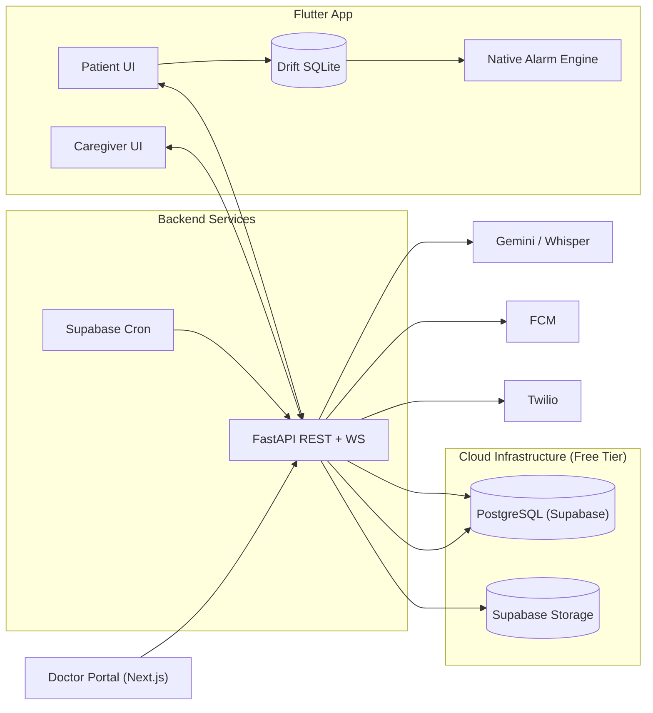
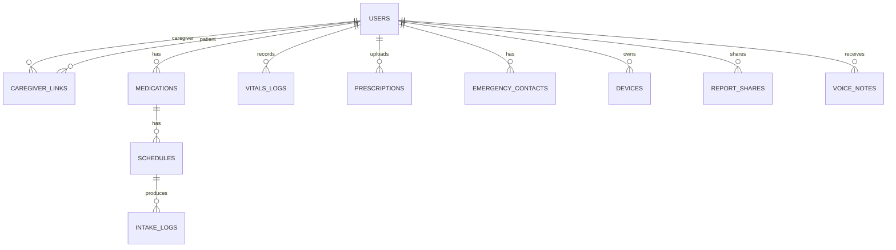
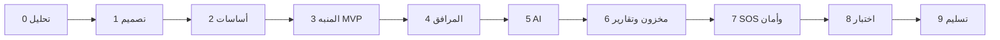

# 🩺 CareElder — الخطة الشاملة للمشروع (Master Project Plan)

> تطبيق ذكي لرعاية كبار السن: تذكير صارم بالأدوية، مسح الروشتات بالذكاء الاصطناعي، تسجيل القياسات بالصوت، متابعة لحظية من الأهل، إدارة مخزون الدواء، تقارير للطبيب، وزر استغاثة.
> المصدر: [original/](original/) · تفاصيل أعمق: [USE_CASES](USE_CASES.md) · [ARCHITECTURE](ARCHITECTURE.md) · [DATABASE](DATABASE.md) · [API_SPEC](API_SPEC.md) · [AI_PIPELINE](AI_PIPELINE.md) · [ROADMAP](ROADMAP.md) · [CONVENTIONS](CONVENTIONS.md) · [SECURITY](SECURITY.md)

---

## 1. نظرة عامة

| البند | التفاصيل |
|---|---|
| **المشكلة** | نسيان الأدوية، صعوبة الكتابة على الموبايل لكبار السن، قلق الأهل البعيدين، نفاد الدواء فجأة، زيارات طبيب مبنية على الذاكرة |
| **الحل** | تطبيق موبايل بواجهتين (مريض/مرافق) + Backend ذكي + بوابة ويب للطبيب |
| **المستخدمون** | 👴 المريض (Senior) · 👨‍👩‍👧 المرافق (Caregiver) · 🩺 الطبيب (Doctor – بدون تثبيت) · 🛠️ الأدمن |
| **اللغات** | العربية (عامية مصرية + فصحى) والإنجليزية، RTL كامل |
| **مبادئ التصميم** | Zero-Typing، أزرار كبيرة، تباين عالي (WCAG AA/AAA)، صوت TTS في كل خطوة، Offline-First |

### مؤشرات النجاح (KPIs)
- نسبة الالتزام الدوائي ≥ 90% للمستخدمين التجريبيين.
- دقة OCR للروشتات ≥ 85% (قبل التأكيد البشري).
- دقة استخراج القياسات الصوتية ≥ 95%.
- زمن وصول تنبيه المرافق < 5 ثوانٍ.
- المنبه يعمل 100% بدون إنترنت وبعد إعادة تشغيل الهاتف.

---

## 2. الميزات (Use Cases) والأولويات — MoSCoW

| ID | الميزة | الممثل | الأولوية |
|---|---|---|---|
| UC-01 | منبه الدواء الصارم (Full-Screen، Offline، Boot Recovery، TTS) | المريض | **Must** |
| UC-02 | مسح الروشتة بالـ AI (OCR + LLM → JSON + بطاقة تأكيد لو الثقة < 85%) | المرافق/المريض | **Must** |
| UC-03 | تسجيل القياسات بالصوت + فرز طبي (طبيعي/حدّي/حرج) | المريض | **Must** |
| UC-04 | متابعة المرافق اللحظية + سلّم التصعيد (0 / +15 / +30 / +60 دقيقة) + رسائل صوتية من الأحفاد | المرافق | **Must** |
| UC-05 | مخزون الأقراص + توقع النفاد + تنبيه قبل 5 أيام + طلب صيدلية عبر WhatsApp + مراقبة الصلاحية | المرافق | **Should** |
| UC-06 | تقرير طبي (PDF) + QR مشفّر مؤقت لبوابة الطبيب | الطبيب | **Must** |
| UC-07 | زر الاستغاثة SOS (GPS + FCM + SMS/Call) | المريض | **Must** |
| UC-08 | كشف التداخلات الدوائية (Drug Interactions) | النظام | Could |
| UC-09 | مساعد صوتي محادثي (أسئلة عن الأدوية) | المريض | Could |
| UC-10 | تكامل ساعات ذكية / أجهزة قياس Bluetooth | المريض | Won't (v1) |

---

## 3. الستاك المقترح (Recommended Tech Stack)

### 📱 Mobile (Patient + Caregiver)
| الطبقة | الاختيار | السبب |
|---|---|---|
| Framework | **Flutter 3.x (Dart)** | تطبيق واحد Android/iOS، أداء ممتاز، دعم RTL |
| State Management | **Riverpod 2** (+ `riverpod_generator`) | قابل للاختبار وبسيط |
| Navigation | **go_router** | Deep links (فتح شاشة المنبه / الـ QR) |
| Local DB | **Drift (SQLite)** | Offline-First + استعلامات typed |
| Networking | **Dio** + Interceptors (JWT refresh, retry) | |
| Models | **freezed + json_serializable** | |
| Alarms | `android_alarm_manager_plus` + `flutter_local_notifications` (fullScreenIntent) + كود Native Kotlin لـ Boot Receiver | منبه صارم يتخطى Doze |
| Voice | `speech_to_text` (on-device) / رفع الصوت للسيرفر (Whisper) + `flutter_tts` | |
| Camera | `camera` + `image_cropper` + `google_mlkit_text_recognition` (معاينة محلية) | |
| Realtime | `web_socket_channel` + **FCM** | |
| Charts | `fl_chart` | |
| Location | `geolocator` | SOS |

### ⚙️ Backend
| الطبقة | الاختيار |
|---|---|
| API | **Python 3.12 + FastAPI** (async) + Pydantic v2 |
| ORM / Migrations | **SQLAlchemy 2.0 (async)** + **Alembic** |
| Database | **PostgreSQL 16** (+ TimescaleDB اختياري للقياسات) |
| Cache / Broker | Optional Redis later; not required for the MVP |
| Background Jobs | **Supabase Cron + protected FastAPI job endpoints** (مراقب الجرعات الفائتة وتنبيهات المخزون والصلاحية) |
| Realtime | FastAPI WebSockets + FCM fallback |
| Auth | OTP عبر الهاتف + **JWT** (Access 15د / Refresh 30 يوم)، RBAC |
| Storage | **Supabase Storage** (S3-compatible) للروشتات والصوتيات |
| PDF | **WeasyPrint** + Jinja2 (دعم عربي) |
| Notifications | **Firebase Cloud Messaging** · **Twilio** (SMS/Voice) · WhatsApp deep link (`wa.me`) |

### 🤖 AI Layer
| المهمة | الاختيار الأساسي | البديل/Fallback |
|---|---|---|
| OCR + هيكلة الروشتة | **Gemini 2.x Flash (Vision) مع Structured Output (JSON Schema)** | Google Cloud Vision OCR + LLM |
| مطابقة أسماء الأدوية | قاعدة بيانات أدوية مصرية محلية + Fuzzy matching (`rapidfuzz`) | |
| Speech-to-Text | **Whisper (faster-whisper large-v3)** أو Gemini Audio | `speech_to_text` على الجهاز |
| استخراج الأرقام من الكلام | Regex + قاموس أرقام عامية + LLM Fallback | |
| الفرز الطبي | **Rule Engine حتمي** (AHA/WHO) — بدون AI عمداً للأمان | |

### 🌐 Doctor Portal + Admin
- **Next.js 15 (React + TypeScript)** + **Tailwind CSS** + shadcn/ui + Recharts.
- (المشروع الحالي فيه Vite + React + Tailwind — ممكن نستخدمه كأساس للبوابة لو حابب نفضل على Vite.)

### 🚀 DevOps & Cloud
- **قاعدة البيانات والتخزين:** **Supabase** (PostgreSQL 16 + Storage للروشتات والصوتيات).
- **المهام المجدولة:** **Supabase Cron** يستدعي endpoints داخلية محمية؛ Redis يضاف فقط إذا ظهرت حاجة فعلية للكاش أو queue.
- **التشغيل المحلي:** تشغيل مباشر وسريع عبر Python `uv` بدون الحاجة لتثبيت Docker.
- **GitHub Actions**: lint (ruff, flutter analyze) → tests → build → deploy.
- Hosting: Railway / Render / VPS (Hetzner) للـ Backend، Vercel للبوابة.
- Monitoring: **Sentry** (موبايل + باك) · Prometheus/Grafana (اختياري).

---

## 4. معمارية النظام



### مبدأ Offline-First
1. كل الكتابات تتم في SQLite أولاً مع `sync_status = pending`.
2. Sync Queue تُرسل عند عودة الإنترنت (Idempotency-Key لكل عملية).
3. حل التعارضات: Last-Write-Wins للبيانات العادية، والسيرفر هو المرجع لجداول الأدوية التي يعدّلها المرافق.

---

## 5. قاعدة البيانات (ERD)



| الجدول | أهم الحقول |
|---|---|
| `users` | id, phone, name, role (patient/caregiver/admin), language, birth_date, created_at |
| `caregiver_links` | caregiver_id, patient_id, pairing_code, status, permissions_mask, linked_at |
| `medications` | patient_id, name, trade_name, active_ingredient, form, strength, pill_image_url, stock_count, alert_threshold_days, expiry_date |
| `schedules` | medication_id, time_of_day, days_mask, dose_amount, meal_relation, instructions_ar, is_active |
| `intake_logs` | schedule_id, patient_id, scheduled_time, actual_time, status (taken/snoozed/missed/skipped), reason, logged_offline |
| `vitals_logs` | patient_id, type (bp/glucose/pulse), value_primary, value_secondary, meal_context, band (normal/borderline/critical), raw_transcript, recorded_at |
| `prescriptions` | patient_id, image_url, doctor_name, raw_extracted_json, confidence, verified_at |
| `emergency_contacts` | patient_id, name, phone, relationship, is_primary, notify_sms, notify_call |
| `devices` | user_id, fcm_token, platform, last_seen |
| `report_shares` | patient_id, token_hash, expires_at, scope, views_count |
| `voice_notes` | from_user, to_patient, audio_url, attached_medication_id |
| `alerts` | patient_id, type, tier, payload, sent_at, acknowledged_at |

---

## 6. الـ API الأساسية (v1)

| Method | Endpoint | الوصف |
|---|---|---|
| POST | `/auth/otp/request` · `/auth/otp/verify` · `/auth/refresh` | تسجيل الدخول |
| POST | `/caregiver/pair` · GET `/caregiver/patients` | الربط |
| CRUD | `/medications` · `/schedules` | الأدوية والمواعيد |
| POST | `/adherence/log` | تسجيل جرعة + خصم المخزون + بث WS |
| POST | `/sync/batch` | مزامنة Offline |
| POST | `/ai/scan-prescription` | صورة → JSON أدوية |
| POST | `/ai/parse-voice-vitals` | صوت → قراءة + تصنيف |
| CRUD | `/vitals` | القياسات |
| GET | `/inventory/forecast` · POST `/inventory/refill-order` | المخزون |
| GET | `/reports/doctor-pdf?days=30` · POST `/reports/share` | التقارير و QR |
| GET | `/public/report/{token}` | بوابة الطبيب |
| POST | `/emergency/sos` | الاستغاثة |
| WS | `/ws/patient/{id}` | البث اللحظي للمرافق |

**عقد OCR (JSON):**
```json
{ "drug_trade_name": "Glucophage", "dosage_mg": 500, "frequency_per_day": 2,
  "meal_relation": "after_meals", "times": ["08:30","20:30"],
  "inventory_pills": 60, "confidence_score": 0.96 }
```

---

## 7. هيكل المستودع (Monorepo)

```
careelder/
├── apps/
│   ├── mobile/                 # Flutter
│   │   └── lib/
│   │       ├── core/           # alarms/, network/, theme/, tts/, db/, sync/
│   │       ├── features/
│   │       │   ├── auth/
│   │       │   ├── adherence_alarm/
│   │       │   ├── medications/
│   │       │   ├── prescription_ocr/
│   │       │   ├── voice_vitals/
│   │       │   ├── caregiver_dashboard/
│   │       │   ├── inventory/
│   │       │   ├── reports/
│   │       │   └── emergency_sos/
│   │       │       └── {data, domain, presentation}/
│   │       └── main.dart
│   └── doctor-portal/          # Next.js
├── services/
│   └── api/                    # FastAPI
│       ├── app/
│       │   ├── api/v1/         # routers
│       │   ├── core/           # config, security, deps
│       │   ├── models/         # SQLAlchemy
│       │   ├── schemas/        # Pydantic
│       │   ├── services/       # business logic (triage, inventory, escalation)
│       │   ├── ai/             # ocr.py, stt.py, parsers.py
│       │   ├── workers/        # celery tasks
│       │   └── templates/      # PDF report
│       ├── alembic/
│       └── tests/
├── infra/                      # docker-compose.yml, nginx, CI
├── docs/                       # هذا الملف، ERD، use cases، UML
└── .github/workflows/
```

---

## 8. مراحل التنفيذ (Roadmap) — ~16 أسبوع

| المرحلة | المدة | المخرجات |
|---|---|---|
| **0. التحليل والتخطيط** | أسبوع 1 | SRS، Use Cases، UML (Use Case / Sequence / Class)، Personas |
| **1. التصميم UX/UI** | أسبوع 2–3 | Wireframes + Figma Hi-Fi (وضع المريض المبسّط + وضع المرافق)، Design System بتباين عالي، اختبار مع 3–5 كبار سن |
| **2. الأساسات** | أسبوع 3–4 | Monorepo، إعداد Supabase، DB schema + Alembic، Auth OTP/JWT، CI، هيكل Flutter + Theme + Localization |
| **3. MVP الأدوية والمنبه** ⭐ | أسبوع 5–7 | CRUD أدوية/مواعيد، Drift DB، المنبه الصارم Full-Screen، Boot Recovery، TTS، تسجيل الجرعة Offline + Sync |
| **4. المرافق والتصعيد** | أسبوع 7–8 | Pairing، Dashboard لحظي (WS)، FCM، Supabase Cron watcher، سلم التصعيد، الرسائل الصوتية |
| **5. طبقة الذكاء الاصطناعي** | أسبوع 9–11 | مسح الروشتة + بطاقة التأكيد، قاعدة أدوية مصرية، القياسات الصوتية بالعامية + Rule Engine للفرز |
| **6. المخزون والتقارير** | أسبوع 11–12 | توقع النفاد، تنبيه 5 أيام، طلب WhatsApp، الصلاحية، PDF عربي، QR + بوابة الطبيب |
| **7. SOS والأمان** | أسبوع 13 | زر الاستغاثة + GPS + Twilio، تشفير، Rate limiting، Audit logs |
| **8. الاختبار والتحسين** | أسبوع 14–15 | Unit/Integration/E2E، اختبار ميداني (Pilot) مع عائلات، إصلاحات، أداء وبطارية |
| **9. التسليم** | أسبوع 16 | Deploy، APK موقّع، توثيق، فيديو Demo، عرض المناقشة والبحث |



### معايير قبول الـ MVP (نهاية المرحلة 4)
- [ ] المنبه يرن في الموعد بدون إنترنت، فوق شاشة القفل، وبعد Restart.
- [ ] المريض يؤكد الجرعة بضغطة واحدة ويظهر التأكيد عند المرافق خلال ثوانٍ.
- [ ] تصعيد تلقائي للمرافق عند عدم التأكيد خلال 30 دقيقة.

---

## 9. تقسيم الفريق المقترح (4–5 أفراد)

| الدور | المسؤوليات |
|---|---|
| Team Lead / Backend | FastAPI، DB، Supabase Cron، DevOps |
| Mobile Dev 1 | المنبهات Native، Offline/Sync، واجهة المريض |
| Mobile Dev 2 | واجهة المرافق، Charts، SOS، Localization |
| AI Engineer | OCR، STT، Parsers، قاعدة الأدوية، تقييم الدقة |
| UI/UX + QA + Docs | Figma، اختبار الاستخدام، التوثيق، Doctor Portal |

المنهجية: **Scrum** بسبرنت أسبوعين، GitHub Projects، Conventional Commits، Code Review إلزامي.

---

## 10. الاختبار والجودة

| النوع | الأدوات | التغطية |
|---|---|---|
| Unit (Backend) | pytest, pytest-asyncio | Triage rules، Inventory forecast، Escalation ≥ 80% |
| Unit/Widget (Flutter) | flutter_test, mocktail | |
| Integration | httpx + Testcontainers (Postgres) | |
| E2E | Flutter `integration_test` / Patrol | سيناريو المنبه كامل |
| AI Evaluation | Dataset من 100+ روشتة و 200 تسجيل صوتي | Precision/Recall لكل حقل |
| Usability | SUS Questionnaire مع كبار السن | هدف ≥ 75 |

---

## 11. الأمان والخصوصية

- بيانات صحية حساسة → تشفير TLS 1.3، تشفير الحقول الحساسة at-rest، تشفير SQLite المحلي (SQLCipher).
- روابط الطبيب: Token عشوائي مُجزّأ (hash) + انتهاء صلاحية 24–72 ساعة + Read-only.
- RBAC + صلاحيات المرافق (`permissions_mask`).
- موافقة صريحة (Consent) على مشاركة البيانات، والتزام بمبادئ قانون حماية البيانات المصري 151/2020 و HIPAA/GDPR كمرجعية.
- إخلاء مسؤولية طبي: الـ AI مساعد فقط، والتأكيد البشري إلزامي للروشتات.

---

## 12. المخاطر وخطط المعالجة

| الخطر | الأثر | المعالجة |
|---|---|---|
| قيود أندرويد على المنبهات (Doze / شركات زي Xiaomi) | عالي | Exact alarms + توجيه لإيقاف Battery Optimization + اختبار على أجهزة متعددة |
| ضعف دقة OCR لخط الأطباء | عالي | Human-in-the-loop + قاعدة أدوية + Fuzzy matching |
| فهم العامية في الصوت | متوسط | Whisper + قاموس أرقام عامية + تأكيد صوتي |
| تكلفة APIs | متوسط | Caching، Flash models، حدود استخدام |
| صعوبة الاستخدام لكبار السن | عالي | اختبارات مبكرة، واجهة مبسطة جداً، TTS |
| ضيق الوقت | عالي | الالتزام بأولويات MoSCoW، MVP أولاً |

---

## 13. مخرجات مشروع التخرج

- [ ] كتاب المشروع (SRS، التصميم، التنفيذ، الاختبار، النتائج).
- [ ] مخططات UML و ERD.
- [ ] كود المصدر على GitHub + README.
- [ ] APK + بوابة الطبيب منشورة.
- [ ] Postman Collection / Swagger.
- [ ] فيديو Demo (3–5 دقائق) + عرض تقديمي.

---

## 14. الخطوات التالية (Next Steps)

1. `git init` في جذر المشروع ورفعه على GitHub (Private).
2. تحديد أعضاء الفريق وتوزيع الأدوار (القسم 9).
3. بدء Sprint 1 حسب [ROADMAP.md](ROADMAP.md).
4. `flutter create` داخل `apps/mobile` و FastAPI skeleton داخل `services/api` (Sprint 2).
5. إعداد المتغيرات السحابية: ضبط بيانات Supabase داخل `infra/.env` والتشغيل عبر `uv`.
